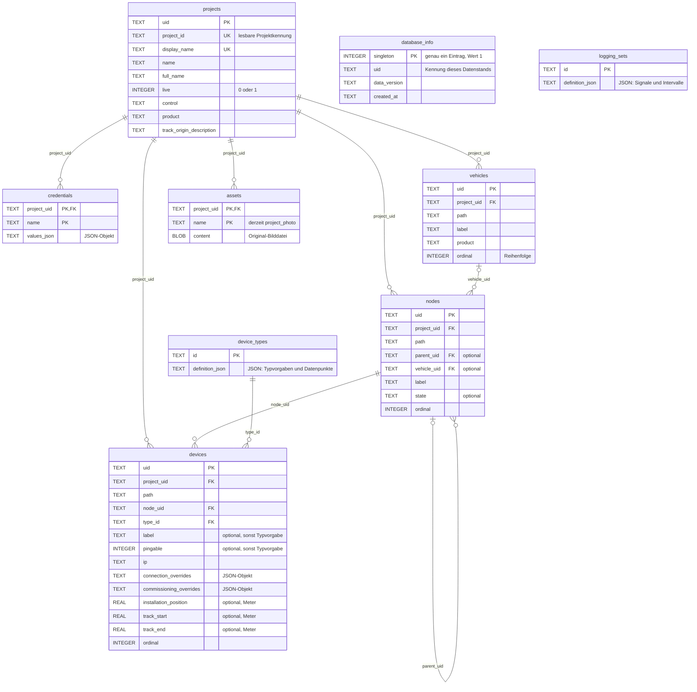

# Lokale Stammdatenbank als SSOT

## Aktueller Stand: lokale Arbeitsdatenbank, Format 4

Die Anwendung kann den ausgewählten Bestand inzwischen direkt bearbeiten.
Unter **Einstellungen** stehen Projekteditor, Stammdateneditor und Gerätekatalog
als getrennte Editoren bereit. Projekte dürfen beliebige allgemeine Nodes
enthalten. Kategorien stehen in `device_categories`; Gerätetypen referenzieren
sie über `category_id`.
Format 4 ergänzt typgebundene Dokumentationsfelder und ihre Werte je Gerät.

Lesende Zugriffe bleiben schreibgeschützt. Schreibvorgänge verwenden eine eigene
Transaktion mit Konflikterkennung. Beim ersten Speichern eines älteren Formats
wird vor der additiven Migration eine Sicherung angelegt. Details und Bedienung:
[Engineering / Planung](engineering.md).

Die folgende Beschreibung dokumentiert den ursprünglichen Format-1-Stand.
Ihre Angaben zum ausschließlich lesenden Betrieb, zur zwingenden Zentrale und
zur Verteilung neuer Dateien als regulärem Speicherweg sind historisch.

## Ursprünglicher Stand: Format 1

WieDAN hat eine lokale SQLite-Anbindung für den gesamten Datenstamm. **Eine
Datenbank enthält sämtliche Projekte, Anlagenstrukturen, Fahrzeuge, Geräte,
Gerätetypdefinitionen, Datenpunkte, Logging-Vorlagen, Zugangsdaten und Projektbilder.** Die Anwendung öffnet
diese Datenbank ausschließlich lesend (`mode=ro`, zusätzlich `query_only`).
Stammdatenpflege und Synchronisation gehören nicht zum normalen Arbeitsablauf.

## Verbindung und Verteilung

Ohne konfigurierte Verbindung wird einmalig
`%LOCALAPPDATA%/WieDAN/stammdaten.sqlite` als Kopie der mitgelieferten
`src/wiedan/data/stammdaten.sqlite` bereitgestellt. Die fertige Datenbank ist die
SSOT; die Anwendung enthält keinen YAML-Import für Stammdaten. Eine vorhandene
lokale Datenbank wird nicht überschrieben.

Über das **Zahnrad unten links → Einstellungen** wird der lokale Datenbankpfad
eingetragen oder mit **Durchsuchen** ausgewählt. **Übernehmen** prüft Format und
Datenkonsistenz, speichert die Verbindungseinstellung und lädt bei einem Wechsel
alle Ansichten neu. Die Datenbankdatei wird dabei nicht verändert. Im Dialog stehen
außerdem Datenstand, Format und Projektanzahl der aktiven Datenbank.
Der Dialog ist auch über **Datei → Einstellungen** erreichbar.
Ist die gespeicherte Datei beim Start nicht verfügbar oder inkompatibel, kann
direkt eine andere Datenbank ausgewählt werden.

Der Sonnen-/Mond-Button über dem Zahnrad wechselt mit einem Klick zwischen hellem
und dunklem Design. Theme und Datenbankpfad werden lokal in
`%LOCALAPPDATA%/WieDAN/settings.json` gespeichert.

Für die erste Verteilung genügt dieser Ablauf:

1. Einen vollständigen Datenstand bereitstellen und versioniert im Netzlaufwerk ablegen.
2. Die gewünschte Datei auf den lokalen Rechner kopieren.
3. Diese lokale Datei in WieDAN auswählen.

Es gibt keinen Import oder Export einzelner Projekte, kein automatisches
Zurückschreiben und keine Verbindung zu einem Remote-SQL-Server. Die ausgewählte
Datei wird nicht stillschweigend durch eine andere Version ersetzt. Ein
Softwareupdate aktualisiert die Stammdaten nicht automatisch.

## Datenmodell und Versionen

Projekt, Fahrzeug, Strukturknoten und Gerät besitzen stabile UUIDs. Lesbare
Gerätepfade bleiben zusätzlich für die bestehende Oberfläche verfügbar.
Beim ersten Aufbau werden IDs reproduzierbar erzeugt. Bei Änderungen eines
bereitgestellten Datenstands müssen vorhandene UUIDs erhalten bleiben; insbesondere
darf eine Umbenennung keine neue Identität erzeugen. Die archivierten Quellen
dienen nicht mehr der Stammdatenpflege.

Die Gerätedaten enthalten drei optionale Positionsfelder:

- `installation_position`: Einbauposition
- `track_start`: Streckenbeginn des zugeordneten Abschnitts
- `track_end`: Streckenende des zugeordneten Abschnitts

Alle Werte sind Meter relativ zum Strecken-Nullpunkt. Unbekannte Positionen bleiben
`NULL`. Eine Bearbeitung dieser Angaben gehört derzeit nicht zur Oberfläche.

**Formatversion** und **Datenstand** sind getrennt. `PRAGMA user_version` definiert
die Datenbankstruktur, aktuell Format **1**. Die Anwendungskennung unterscheidet
die Stammdatenbank von anderen SQLite-Dateien. `database_info` enthält die
Bezeichnung des Datenstands, eine eindeutige Kennung dieses Stands und den
Erstellungszeitpunkt. Neuere Formate erfordern eine passende WieDAN-Version;
unbekannte Formate werden unverändert abgewiesen. Ein neuer Datenstand innerhalb
desselben Formats benötigt kein Softwareupdate.

## Tabellen und Beziehungen

Das Diagramm zeigt das aktuelle Format 1 aus
[`project_schema.sql`](../src/wiedan/core/project_schema.sql).
`PK` bezeichnet einen Primärschlüssel, `FK` einen Fremdschlüssel und `UK` einen
eindeutigen Wert. Mehrere `PK`-Felder einer Tabelle bilden gemeinsam ihren Schlüssel.
Die Verbindungen zeigen die relational abgesicherten Zuordnungen.



`database_info` beschreibt die gesamte Datei und hat deshalb keine Verbindung zu
einem einzelnen Projekt. Die Formatversion steht separat in `PRAGMA user_version`.
`logging_sets` ist ebenfalls projektübergreifend; seine Typ- und Datenpunktverweise
liegen innerhalb des JSON-Inhalts und sind keine SQL-Fremdschlüssel.

Für `vehicles`, `nodes` und `devices` ist `(project_uid, path)` jeweils eindeutig.
Die Fremdschlüssel von Knoten zu Elternknoten bzw. Fahrzeugen und von Geräten zu
Knoten enthalten zusätzlich `project_uid`. Dadurch können diese Zuordnungen
keine Projektgrenzen überschreiten. Die Indizes `nodes_project` und
`devices_project` unterstützen das Laden eines Projekts.

Ein Knoten ohne Elternknoten und ohne Fahrzeug ist die Zentrale. Fahrzeuge haben
jeweils einen eigenen Wurzelknoten. Untergruppen verweisen über `parent_uid` auf
ihren Elternknoten; Geräte gehören genau einem Knoten. Die Anwendung prüft beim
Öffnen zusätzlich die Wurzelknoten, konsistente Fahrzeugzuordnungen und Zyklen.

## Warum manche Felder wie YAML aussehen

Die strukturierten Textfelder enthalten **JSON, kein gespeichertes YAML**. Bei der
Migration wurden die YAML-Dateien eingelesen und die Inhalte entweder auf
SQL-Spalten verteilt oder als JSON serialisiert. Es handelt sich um ein gemischtes
Datenmodell: Beziehungen und häufig benötigte Stammdaten sind relational,
variable Definitionen liegen als Dokumente innerhalb derselben Datenbank.

| Feld | Inhalt |
| --- | --- |
| `device_types.definition_json` | Typbezeichnung, Kategorie, Erreichbarkeit, Verbindungsparameter, Inbetriebnahmeverbindung und Datenpunktdefinitionen |
| `logging_sets.definition_json` | Bezeichnung und Signalliste mit Gerätetyp, Datenpunkten und Abfrageintervallen |
| `credentials.values_json` | Benannte Zugangsdaten eines Projekts |
| `devices.connection_overrides` | Gerätespezifische Abweichungen von den Verbindungsparametern des Typs |
| `devices.commissioning_overrides` | Gerätespezifische Abweichungen für die Inbetriebnahmeverbindung |

Beispielsweise ist `{}` ein leeres JSON-Objekt: Das Gerät übernimmt dafür die
Typvorgaben. Seine IP-Adresse steht unabhängig davon in der SQL-Spalte `ip`.

Für den bisherigen Umfang ist diese Aufteilung vertretbar: Unterschiedliche
Gerätetypen können unterschiedliche Protokollparameter besitzen, ohne für jede
Variante neue Tabellenspalten einzuführen. Alle Definitionen bleiben Teil der SSOT.
Die Migration ist damit jedoch **keine vollständige relationale Normalisierung**.

Der Nachteil: Einzelne Datenpunkte und Logging-Signale sind keine eigenen Zeilen.
Ihre Beziehungen werden nicht durch SQL-Fremdschlüssel abgesichert. Auch
Typvorgaben wie Kategorie oder Protokoll müssen aus JSON gelesen werden.
Die aktuelle Inhaltsprüfung kontrolliert die JSON-Objekte und grundlegende
Typdefinitionen, aber nicht sämtliche darin enthaltenen Verweise. Die SQL-Struktur
selbst enthält keine `CHECK`-Regeln für die JSON-Inhalte.

Wenn Datenpunkte und Logging-Signale später einzeln gepflegt, über Projekte hinweg
ausgewertet oder einzeln synchronisiert werden sollen, wären eigene Tabellen dafür
sinnvoll. Variable Protokolloptionen können weiterhin JSON bleiben. Das wäre eine
bewusste Weiterentwicklung des Schemas; die heutige Ablage verhindert sie nicht.

## Abgeschlossene Migration und Quellcode

Der bisherige Bestand wurde in `src/wiedan/data/stammdaten.sqlite` übernommen
(Datenstand `2026.10.18`). Die unveränderten Quelldateien einschließlich Bilder
liegen unter `archive/yaml-data-2026-10-18/`. Dieses Archiv wird nicht installiert
und nicht von der Anwendung gelesen. Auch ungenutzte Gerätetypen und alle
Logging-Vorlagen wurden übernommen.

Der migrierte Bestand umfasst 5 Projekte, 78 Fahrzeuge, 451 Geräte,
13 Gerätetypen, 3 Logging-Vorlagen und 5 Projektbilder.

Die ursprüngliche Migration lässt sich bei Bedarf in eine neue Datei wiederholen:

```powershell
.venv\Scripts\python.exe -m tools.migrate_yaml build/migration.sqlite --source archive/yaml-data-2026-10-18 --data-version 2026.10.18
```

Das Werkzeug überschreibt keine bestehende Datei. Es baut eine neue Datei auf,
prüft Integrität, Beziehungen und Inhaltsgleichheit mit den Quellen und stellt
sie erst nach erfolgreichem Abschluss bereit. Es ist kein Werkzeug zur Pflege
neuer Datenstände; diese bauen auf der bestehenden Datenbank mit ihren stabilen
Kennungen auf.

- `core/model.py`: gemeinsames Projektmodell ohne YAML-Leser.
- `core/project_database.py`: lesender Datenbankzugriff, Auswahl und Validierung.
- `core/project_schema.sql`: SQL-Struktur des Formats 1.
- `tools/migrate_yaml.py`: isoliertes Werkzeug für die ursprüngliche Migration.

Projekte, Fahrzeuge, Strukturknoten, Geräte und Bilder sind relational gespeichert.
Variable Gerätetypdefinitionen und Logging-Vorlagen stehen als JSON in eigenen
Tabellen; sie werden einmalig gehalten und nicht je Projekt dupliziert.

Die Datenbank enthält auch die bisherigen Projektzugangsdaten und ist nicht
verschlüsselt. Gerätetypdefinitionen liegen einmalig in der gemeinsamen Datenbank.

## Scalance-Entwürfe: Entscheidung noch offen

Die bisherige lokale YAML-Ablage der Scalance-Entwürfe bleibt vorläufig bestehen.
Tabellenbearbeitung verändert damit nicht die SSOT und bleibt beim Wechsel des
Stammdatenstands erhalten. Ob diese Konfigurationen später Teil des verwalteten
Datenstamms oder eigenständige Arbeitsdaten werden, ist ausdrücklich noch offen.
Es wurde dafür keine neue Synchronisations- oder Versionsverwaltung eingeführt.

Die Anbindung eines Remote-SQL-Servers sowie Pflege, Freigabe und Abgleich von
Stammdatenständen bleiben spätere Aufgaben.
